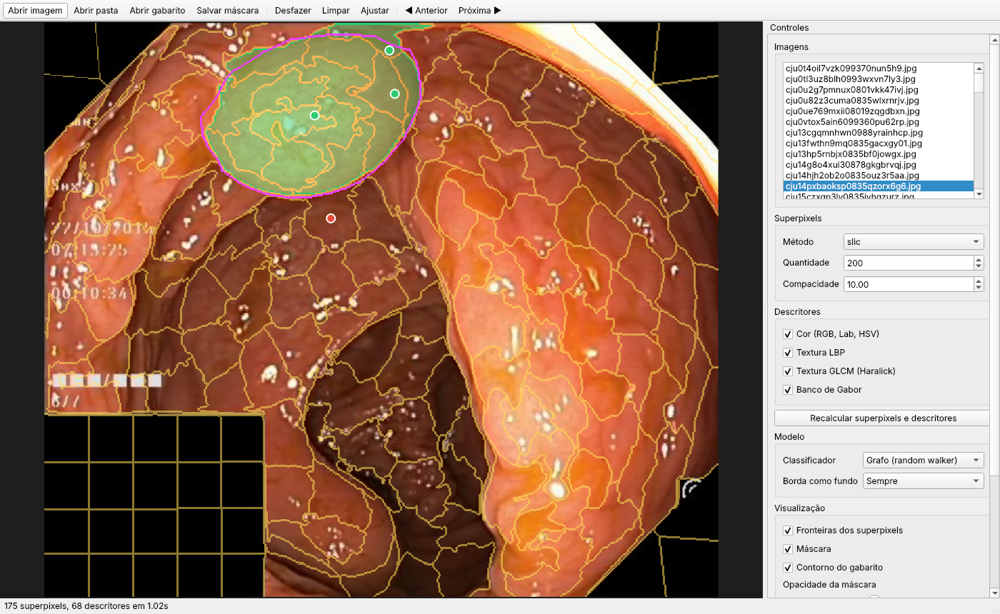

# PolypSegmentation

Protótipo de **segmentação assistida de pólipos** em imagens de colonoscopia com
superpixels e descritores de cor e textura. O usuário clica em alguns pontos do
pólipo (e, se quiser, do fundo); o sistema rotula os superpixels clicados e
propaga a decisão para o resto da imagem. É a primeira etapa de um trabalho que
depois evolui para a segmentação automática.



*3 cliques de pólipo (verde) e 1 de fundo (vermelho): Dice 0,95 contra o gabarito (contorno magenta). Imagem do [Kvasir-SEG](https://arxiv.org/abs/1911.07069) (Jha et al., 2020).*

## Por que PySide6 (Qt 6)

- É o binding **oficial** do Qt para Python, mantido pela Qt Company, com licença LGPL.
- É nativo e roda offline em Linux, Windows e macOS, sem servidor web nem GPU.
- O `QGraphicsView` dá zoom, arraste e sobreposições sobre imagens grandes com
  baixa latência, que é o que importa numa ferramenta de anotação por cliques.
- O estilo Fusion do Qt 6 segue automaticamente o tema claro ou escuro do sistema.

Alternativas consideradas: napari (bom para microscopia, pesado para um fluxo
simples de cliques), Gradio e NiceGUI (web, mas com latência maior a cada clique
e menos controle de desenho).

## Instalação

Requer Python 3.11 ou mais novo. Com [uv](https://docs.astral.sh/uv/):

```bash
uv venv && uv pip install -e ".[dev]"
```

Ou com pip:

```bash
python3 -m venv .venv && source .venv/bin/activate
pip install -e ".[dev]"
```

No Linux sem ambiente gráfico completo, o Qt pode precisar de
`libegl1 libgl1 libxkbcommon0 libfontconfig1 libdbus-1-3`.

### Bases de dados

```bash
pip install -e ".[data]"
python scripts/download_data.py
```

O script baixa para `data/` o Kvasir-SEG completo (1000 imagens), uma base de
desenvolvimento com 120 imagens do CVC-ClinicDB do treino do PraNet
(`data/CVC-ClinicDB-dev`, sem sobreposição com o teste) e os cinco
conjuntos de teste do protocolo PraNet: CVC-300 (60), CVC-ClinicDB (62),
CVC-ColonDB (380), ETIS-LaribPolypDB (196) e Kvasir (100). Os arquivos vêm de
espelhos no Hugging Face, porque o site oficial do Kvasir-SEG não passa na
verificação de certificado. Ao publicar, cite os artigos originais de cada base.

## Uso da interface

```bash
polypseg-gui                          # abre vazio
polypseg-gui caminho/imagem.jpg       # uma imagem
polypseg-gui data/Kvasir-SEG          # pasta com images/ e masks/
```

| Ação | Comando |
| --- | --- |
| Marcar pólipo | botão esquerdo |
| Marcar fundo | botão direito |
| Caixa em volta de um pólipo | Ctrl + arrastar com o botão esquerdo |
| Remover caixa | Ctrl + botão direito sobre ela |
| Zoom / arrastar | roda do mouse / botão do meio |
| Desfazer / limpar | Ctrl+Z / Esc |
| Imagem anterior / próxima | PgUp / PgDn |
| Salvar máscara | Ctrl+S |

Ao abrir uma pasta no formato do Kvasir-SEG (`images/` e `masks/`), o gabarito é
carregado sozinho e o painel mostra o Dice e o IoU a cada clique. Ao salvar, além
do PNG da máscara é gravado um `.json` com os cliques, a configuração e o
**tempo de anotação**, útil para medir custo de anotação no artigo.

**Caixas (opcional).** Com uma ou mais caixas desenhadas, cada caixa é segmentada à
parte ([boxes.py](src/polypseg/boxes.py)): superpixels, descritores e grafo são
calculados só num recorte com 15% de folga em volta da caixa, com o orçamento inteiro
de superpixels; a folga entra como fundo, a estrela não sai da caixa e a máscara é
cortada nela. A máscara final é a união das caixas. Cliques fora de todas as caixas são
ignorados (ali já é fundo). Onde duas caixas se cruzam, um clique de fundo vale para as
duas e um clique de pólipo vai só para a caixa de centro mais próximo, medido em
unidades do tamanho de cada caixa. Sem caixas, a imagem inteira é usada, como antes.
Ainda não há avaliação com caixas.

No painel dá para trocar o algoritmo de superpixels (SLIC, Felzenszwalb,
watershed), a quantidade (10 a 20000) e a compacidade, os grupos de descritores, o
modelo e os módulos do método (arestas de borda, estrela, prior geodésico, refino
por pixel, relevo local e suavização da borda). Em "Visualização" escolhem-se as cores da máscara,
das fronteiras e do gabarito e a espessura das fronteiras; essas preferências ficam
salvas entre sessões.

## Método

1. **Pré-processamento:** reflexos especulares (pixels claros e pouco saturados)
   são preenchidos com a cor vizinha.
2. **Superpixels:** SLIC no espaço Lab (padrão: 400 regiões).
3. **Descritores por superpixel (68 no total):**
   - cor: média e desvio em RGB, Lab e HSV, com a matiz como cos/sen;
   - LBP uniforme com raios 1 e 2 (histogramas);
   - GLCM de Haralick restrita aos pares de pixels dentro do superpixel, em 4
     direções (contraste, dissimilaridade, homogeneidade, energia, correlação, entropia);
   - banco de Gabor com 2 frequências e 4 orientações (média e desvio da magnitude).
4. **Grafo de superpixels com arestas cortadas pela borda** (`boundary_edges`):
   arestas entre vizinhos com peso `exp(-‖fᵢ − fⱼ‖² / (β · med)) · exp(-b̄ᵢⱼ / (γ · med))`,
   em que `b̄ᵢⱼ` é a média de um mapa de borda **ao longo da fronteira** entre os dois
   superpixels (princípio dos *intervening contours*). O mapa combina o gradiente em
   Lab com o vale escuro no canal azul, que marca a borda do pólipo
   (Bernal et al., 2015, WM-DOVA), e é zerado na moldura preta.
5. **Prior em estrela centrado no clique** (`radial_prior`): em volta do 1º clique
   de pólipo, a evidência de borda e o escurecimento ao se afastar do clique (a luz
   sai junto da câmera, então a cúpula do pólipo é mais clara que o entorno) são
   amostrados em coordenadas polares. Uma programação dinâmica circular escolhe o
   contorno fechado r(θ) de menor custo, com |Δr| limitado, sem atravessar a moldura.
   É a busca radial do WM-DOVA, condicionada ao clique, com a restrição de forma em
   estrela de Veksler (2008) e Gulshan et al. (2010). **Os cliques seguintes viram
   restrições da própria DP:** o contorno passa por fora dos cliques de pólipo e por
   dentro dos de fundo. O contorno vira um prior suave no random walker, com peso
   relativo ao grau médio do grafo e dividido pelo número de cliques.
6. **Propagação:** os superpixels clicados são sementes. Os superpixels da borda
   da imagem e os encostados na moldura preta entram como fundo, a menos que tenham
   sido clicados como pólipo. Um *random walker* com os priors calcula a
   probabilidade de pólipo de cada superpixel. Além da estrela, entra um **prior
   geodésico** (`geodesic_prior`, Bai e Sapiro, 2007): cada superpixel é puxado para
   d_fundo / (d_pólipo + d_fundo), com as distâncias de caminho mínimo no próprio grafo
   (custo −log w por aresta, a floresta de caminhos mínimos da IFT de Falcão et al.,
   2004) até os cliques de pólipo e até as sementes de fundo. O peso (0,2) é relativo
   ao grau médio e dividido pelo número de cliques, como o da estrela.
7. **Refino por pixel** (`pixel_refine`): um random walker por pixel (Grady, 2006)
   decide só a faixa de ±14 px em volta da borda da máscara, com o interior e o
   exterior da faixa como sementes. Só os pixels da faixa entram no sistema linear.
8. **Pós-processamento:** suavização opcional da borda (`smooth_sigma`, desligada
   por padrão; suaviza a distância assinada e corta no nível zero, um passo de fluxo
   por curvatura), depois mantém só as regiões conexas que contêm cliques de pólipo
   e preenche buracos.

Os passos 4, 5, 7 e o prior geodésico vêm ligados por padrão. Também existem, desligados: o relevo
local no mapa de borda (`relief_map`, pseudo-elevação por sombreamento coaxial no
canal R mais o *Local Relief Model* da arqueologia com LiDAR), um grupo de
descritores de relevo por Hessiana (`FeatureConfig(relief=True)`) e o balanceamento
dos grupos de descritores na distância do grafo (`balance_groups`). Nenhum deles
melhorou a avaliação.

Os modelos alternativos são: `hybrid` (um SVM linear dá a probabilidade inicial
e o random walker suaviza), `svm` (SVM linear) e `rf` (Random Forest). Todos
foram piores que o grafo puro, porque treinar classificadores com poucos cliques
gera muita variância. Também há `xgb` (XGBoost, 100 árvores de profundidade 3, com as
classes balanceadas como no `rf`) e `xgb_graph` (a probabilidade do XGBoost entra como
mais um prior do random walker, junto com a estrela e o geodésico, com peso
`classifier_weight` relativo ao grau). Ambos requerem o extra opcional
`pip install -e ".[xgb]"` e foram piores na base de desenvolvimento do Kvasir:

| Modelo | Dice@1 | Dice@3 | Dice@5 | Dice@10 | NoC@85 | NoC@90 |
| --- | --- | --- | --- | --- | --- | --- |
| grafo (padrão) | 0,725 | 0,860 | 0,899 | 0,937 | 4,89 | 7,20 |
| `xgb` | 0,170 | 0,462 | 0,636 | 0,806 | 9,24 | 9,81 |
| `xgb_graph`, peso 0,05 | 0,680 | 0,803 | 0,866 | 0,916 | 5,82 | 7,96 |
| `xgb_graph`, peso 0,1 | 0,610 | 0,706 | 0,813 | 0,907 | 7,00 | 8,84 |
| `xgb_graph`, peso 0,3 | 0,260 | 0,532 | 0,711 | 0,850 | 8,75 | 9,61 |

Com um clique de pólipo contra dezenas de superpixels de borda, o XGBoost aprende quase
só fundo, e quanto mais ele pesa, pior fica.

**Limitação conhecida:** a estrela supõe uma cúpula mais clara que a mucosa em volta.
Num pólipo mais escuro que o entorno o contorno sai pequeno e o 1º clique piora; na
interface, basta desmarcar "Estrela em volta do clique". Escolher a polaridade por
imagem foi testado e piorou a base de desenvolvimento.

## Avaliação com cliques simulados

```bash
polypseg-eval --data data/Kvasir-SEG --max-clicks 10 --jobs 4 --out results/kvasir.csv
polypseg-eval --data data/TestDataset/ETIS-LaribPolypDB --jobs 4
polypseg-eval --data data/Kvasir-SEG --modules none --jobs 4       # método anterior
polypseg-eval --data data/Kvasir-SEG --list data/dev.txt --jobs 4  # só a base de desenvolvimento
polypseg-eval --data data/Kvasir-SEG --smooth 4 --jobs 4           # com suavização da borda
```

Os cliques seguem o protocolo usual de segmentação interativa: o 1º clique cai no
centro do pólipo e cada novo clique cai no ponto mais interno da maior região de
erro. Um falso negativo vira clique de pólipo e um falso positivo vira clique de
fundo. O script relata Dice e IoU médios por número de cliques e NoC@85/90
(cliques até atingir IoU de 85% ou 90%).

Scripts de apoio:

```bash
python scripts/split_dev.py                    # gera data/dev.txt (200 imagens, semente 0)
python scripts/diagnose.py --data data/Kvasir-SEG --list data/dev.txt --jobs 12   # tetos
python scripts/factorial.py --data data/Kvasir-SEG --list data/dev.txt --jobs 12  # 2⁴ módulos
```

### Protocolo

- **Desenvolvimento:** 200 imagens sorteadas de `data/train.txt` do Kvasir-SEG,
  sem as 100 que também estão no teste Kvasir do PraNet. Todos os parâmetros e
  escolhas de módulos foram feitos só nessa base.
- **Teste:** `val.txt` do Kvasir-SEG (120) e os cinco conjuntos do PraNet.
- Imagens reduzidas para 512 px no maior lado, 10 cliques simulados.

### Diagnóstico com oráculos (desenvolvimento, método anterior)

| Cenário | Dice@1 | Dice@3 | Dice@10 | NoC@85 | NoC@90 |
| --- | --- | --- | --- | --- | --- |
| Método anterior | 0,433 | 0,762 | 0,899 | 8,10 | 9,56 |
| Mesmo grafo, arestas cortadas exatamente na borda do gabarito | 0,772 | 0,883 | 0,926 | 4,58 | 7,17 |

Rotulando cada superpixel pela maioria do gabarito, o IoU máximo é 0,858, 0,890 e
0,917 com 200, 400 e 800 superpixels; com 400, só 51% das imagens conseguem IoU ≥ 0,90.
Depois do 1º clique, 76% dos pixels errados estão a mais de 5 px da borda do gabarito.
Conclusão: o maior espaço estava nas arestas (vazamento), e o NoC@90 era limitado
pelos superpixels.

### Fatorial dos módulos (desenvolvimento)

| Módulos | Dice@1 | Dice@3 | Dice@5 | Dice@10 | NoC@85 | NoC@90 |
| --- | --- | --- | --- | --- | --- | --- |
| nenhum (método anterior) | 0,433 | 0,762 | 0,846 | 0,899 | 8,10 | 9,56 |
| arestas de borda (M2) | 0,546 | 0,789 | 0,864 | 0,911 | 7,01 | 8,78 |
| estrela (M3) | 0,647 | 0,809 | 0,860 | 0,905 | 7,50 | 9,14 |
| refino por pixel (M4) | 0,412 | 0,776 | 0,860 | 0,924 | 6,68 | 8,44 |
| M2 + M3 | 0,690 | 0,832 | 0,876 | 0,912 | 6,53 | 8,72 |
| M2 + M3 + M4 | 0,687 | 0,842 | 0,898 | 0,934 | 5,05 | 7,09 |
| M2 + M3 + M4, com a correção da moldura (padrão atual) | 0,685 | 0,860 | 0,899 | 0,936 | 4,92 | 6,99 |

Efeitos principais sobre NoC@85: M2 −0,96, M3 −0,63, M4 −1,50; o relevo local (M1)
teve efeito nulo (−0,01) e ficou desligado. Os ganhos se somam quase sem interação.
Antes desta etapa, descritores novos (relevo por Hessiana, balanceamento dos grupos)
mudaram o Dice em no máximo 0,02, com intervalos de confiança cruzando zero.

### Teste

**v1: rodada única com a configuração congelada no desenvolvimento.**
A estrela ainda podia atravessar a moldura preta.

**v2.** Depois da v1, um diagnóstico mostrou que nas bases CVC a estrela
do 1º clique ia até a moldura preta (área mediana 2,5 a 8,8 vezes a do pólipo). A
correção (a estrela não atravessa a moldura) foi conferida só na base de
desenvolvimento, mas **foi motivada pelo teste, então a v2 não é uma avaliação
independente**. Uma base de desenvolvimento só com imagens CVC resolveria isso.

| Base | Imagens | Método | Dice@1 | Dice@3 | Dice@5 | Dice@10 | NoC@85 | NoC@90 |
| --- | --- | --- | --- | --- | --- | --- | --- | --- |
| Kvasir-SEG (val) | 120 | anterior | 0,428 | 0,749 | 0,836 | 0,891 | 8,58 | 9,78 |
| | | só cor | 0,470 | 0,763 | 0,830 | 0,890 | 8,11 | 9,53 |
| | | v1 | 0,666 | 0,822 | 0,880 | 0,924 | 5,92 | 7,76 |
| | | **v2** | 0,668 | 0,850 | 0,894 | 0,925 | **5,84** | 7,77 |
| Kvasir (PraNet) | 100 | anterior | 0,419 | 0,757 | 0,828 | 0,891 | 8,18 | 9,65 |
| | | só cor | 0,454 | 0,771 | 0,833 | 0,880 | 8,00 | 9,45 |
| | | v1 | 0,669 | 0,832 | 0,861 | 0,925 | 5,21 | 7,25 |
| | | **v2** | 0,673 | 0,844 | 0,880 | 0,923 | **5,25** | 7,12 |
| CVC-300 | 60 | anterior | 0,690 | 0,764 | 0,815 | 0,858 | 9,27 | 10,00 |
| | | só cor | 0,540 | 0,767 | 0,806 | 0,854 | 9,03 | 10,00 |
| | | v1 | 0,419 | 0,818 | 0,859 | 0,915 | 6,45 | 9,08 |
| | | **v2** | 0,810 | 0,864 | 0,892 | 0,915 | **5,78** | 8,80 |
| CVC-ClinicDB | 62 | anterior | 0,426 | 0,727 | 0,786 | 0,842 | 9,02 | 9,94 |
| | | só cor | 0,479 | 0,695 | 0,793 | 0,852 | 8,53 | 9,65 |
| | | v1 | 0,456 | 0,650 | 0,778 | 0,874 | 7,21 | 8,63 |
| | | **v2** | 0,535 | 0,728 | 0,819 | 0,879 | **6,94** | 8,31 |
| CVC-ColonDB | 380 | anterior | 0,549 | 0,734 | 0,797 | 0,844 | 9,47 | 9,92 |
| | | só cor | 0,503 | 0,719 | 0,787 | 0,843 | 9,23 | 9,88 |
| | | v1 | 0,429 | 0,680 | 0,792 | 0,893 | 7,87 | 9,26 |
| | | **v2** | 0,579 | 0,758 | 0,835 | 0,897 | **7,39** | 9,12 |
| ETIS-LaribPolypDB | 196 | anterior | 0,541 | 0,690 | 0,759 | 0,800 | 9,16 | 9,85 |
| | | só cor | 0,577 | 0,701 | 0,748 | 0,796 | 8,98 | 9,84 |
| | | v1 | 0,582 | 0,760 | 0,825 | 0,886 | 6,33 | 8,43 |
| | | **v2** | 0,584 | 0,778 | 0,841 | 0,885 | **6,16** | 8,35 |

Diferença pareada de NoC@85 contra o método anterior (IC 95% por bootstrap; teste de
Wilcoxon com correção de Holm nas 6 bases):

| Base | v1 | v2 |
| --- | --- | --- |
| Kvasir-SEG (val) | −2,67 [−3,25; −2,10] | −2,74 [−3,33; −2,18] |
| Kvasir (PraNet) | −2,97 [−3,56; −2,38] | −2,93 [−3,49; −2,37] |
| CVC-300 | −2,82 [−3,68; −1,98] | −3,48 [−4,32; −2,67] |
| CVC-ClinicDB | −1,81 [−2,57; −1,07] | −2,08 [−2,87; −1,29] |
| CVC-ColonDB | −1,60 [−1,86; −1,35] | −2,08 [−2,36; −1,80] |
| ETIS-LaribPolypDB | −2,84 [−3,32; −2,38] | −3,01 [−3,48; −2,55] |

Todos com p (Holm) ≤ 6×10⁻⁵, e o ganho se mantém contra o método só com cor.

Leitura dos resultados:

- **O método novo economiza de 1,6 a 3,5 cliques para chegar a IoU 85% em todas as
  bases**, e o NoC@90 deixou de ficar preso perto de 10.
- **Na v1, o 1º clique piorou no CVC-300 (0,69 → 0,42) e no CVC-ColonDB
  (0,55 → 0,43)**, porque a estrela vazava pela moldura; na v2, os dois sobem acima
  do método anterior (0,81 e 0,58).
- **CVC-ClinicDB e CVC-ColonDB continuam as bases mais difíceis** (NoC@85 de 6,9 e
  7,4), com pólipos pequenos e muito contato com a moldura.
- **Tempo:** preparo de cerca de 0,6 s por imagem de 512 px e cerca de 75 ms por
  clique (máximo de cerca de 140 ms), ainda interativo.
- **Suavização da borda:** no desenvolvimento, σ = 4 px deixa as métricas iguais
  (Dice@3 0,870, NoC@85 4,93); sem o refino por pixel ela ajuda (NoC@85 6,46 → 6,09
  com σ = 8). Fica desligada por padrão.

**v3: versão atual, com o prior geodésico.** Escolhido só nas duas bases de
desenvolvimento (NoC@85 4,96 → 4,89 no Kvasir e 7,03 → 6,68 no CVC; ver [TODO.md](TODO.md))
e rodado uma vez no teste. A v2 foi rodada de novo no mesmo ambiente (Python 3.14,
bibliotecas atuais), por isso difere em até 0,08 da tabela acima.

| Base | Imagens | Versão | Dice@1 | Dice@3 | Dice@5 | Dice@10 | NoC@85 | NoC@90 |
| --- | --- | --- | --- | --- | --- | --- | --- | --- |
| Kvasir-SEG (val) | 120 | v2 | 0,679 | 0,849 | 0,894 | 0,922 | 5,91 | 7,61 |
| | | **v3** | 0,706 | 0,835 | 0,888 | 0,933 | **5,75** | 7,69 |
| Kvasir (PraNet) | 100 | v2 | 0,673 | 0,844 | 0,878 | 0,924 | 5,27 | 7,11 |
| | | **v3** | 0,704 | 0,851 | 0,884 | 0,925 | **5,11** | 7,29 |
| CVC-300 | 60 | v2 | 0,810 | 0,864 | 0,890 | 0,910 | 5,80 | 8,80 |
| | | **v3** | 0,815 | 0,851 | 0,868 | 0,906 | **5,88** | 8,83 |
| CVC-ClinicDB | 62 | v2 | 0,535 | 0,731 | 0,824 | 0,882 | 7,02 | 8,29 |
| | | **v3** | 0,586 | 0,764 | 0,843 | 0,902 | **6,58** | 8,31 |
| CVC-ColonDB | 380 | v2 | 0,579 | 0,758 | 0,834 | 0,897 | 7,41 | 9,12 |
| | | **v3** | 0,629 | 0,779 | 0,836 | 0,894 | **7,52** | 9,16 |
| ETIS-LaribPolypDB | 196 | v2 | 0,584 | 0,778 | 0,841 | 0,886 | 6,15 | 8,33 |
| | | **v3** | 0,642 | 0,781 | 0,845 | 0,891 | **6,37** | 8,37 |

Diferença pareada v3 − v2 (IC 95% por bootstrap; Wilcoxon com correção de Holm):

| Base | NoC@85 | p | Dice@1 | p |
| --- | --- | --- | --- | --- |
| Kvasir-SEG (val) | −0,16 [−0,47; +0,13] | 1 | +0,028 [+0,009; +0,047] | 0,10 |
| Kvasir (PraNet) | −0,16 [−0,46; +0,14] | 1 | +0,031 [+0,006; +0,062] | 0,40 |
| CVC-300 | +0,08 [−0,45; +0,63] | 1 | +0,005 [−0,013; +0,024] | 0,70 |
| CVC-ClinicDB | −0,44 [−0,92; +0,05] | 0,36 | +0,051 [+0,017; +0,091] | 0,01 |
| CVC-ColonDB | +0,11 [−0,02; +0,24] | 0,99 | +0,050 [+0,036; +0,064] | 5×10⁻¹⁰ |
| ETIS-LaribPolypDB | +0,22 [+0,01; +0,44] | 0,31 | +0,058 [+0,027; +0,090] | 0,01 |

- **O 1º clique melhora em todas as bases** (Dice@1 +0,005 a +0,058), com
  significância no CVC-ClinicDB, no CVC-ColonDB e no ETIS.
- **O NoC@85 não muda de forma significativa em nenhuma base:** cai no Kvasir e no
  CVC-ClinicDB (−0,16 a −0,44) e sobe no CVC-300, no CVC-ColonDB e no ETIS (+0,08 a
  +0,22). O ganho de NoC@85 do desenvolvimento não se repetiu, e o NoC@90 fica igual
  ou um pouco pior. O prior acerta mais o 1º clique, mas atrapalha um pouco as
  correções finas nas bases com pólipos pequenos.

## Segmentação automática (YOLO-seg)

Sem cliques: um YOLO-seg ([Ultralytics](https://docs.ultralytics.com/tasks/segment/))
detecta cada pólipo com uma caixa e já devolve a máscara da instância; a máscara final é
a união das instâncias. O treino usa o treino do PraNet (900 Kvasir + 550
CVC-ClinicDB), que não se sobrepõe ao `TestDataset`. O ultralytics é AGPL-3, por isso
fica num extra opcional.

```bash
pip install -e ".[yolo,data]"
python scripts/download_data.py --only pranet-train      # data/TrainDataset (1450 pares)
polypseg-auto dataset --src data/TrainDataset --out data/yolo   # polígonos YOLO, 10% para validação
yolo segment train model=yolo11s-seg.pt data=data/yolo/data.yaml imgsz=640 epochs=100 batch=8 patience=20 project=$PWD/results/yolo name=s
polypseg-auto eval --weights results/yolo/s/weights/best.pt --data data/TestDataset/* --out results/yolo.csv
```

A validação (10%, semente 0) serve só para o early stopping. Com 4 GB de GPU, se faltar
memória, use `batch=4` ou `yolo11n-seg.pt`. O `project` é absoluto porque o ultralytics
prefixa caminhos relativos com o `runs_dir` global (`yolo settings`). O `eval` relata Dice e IoU médios por base
(uma imagem sem detecção conta como Dice 0) e quantas imagens ficaram sem detecção.

### Resultados

Treino: YOLO11s-seg pré-treinado no COCO, 100 épocas, 640 px, batch 8, 1,46 h numa RTX
A400 (4 GB, 2,4 GB usados). Na validação (145 imagens do treino), mAP50 de máscara 0,985
e mAP50-95 0,815. Curvas: [docs/yolo/curvas.png](docs/yolo/curvas.png); predições na
validação: [docs/yolo/val_pred.jpg](docs/yolo/val_pred.jpg). Os pesos estão em
`models/yolo11s-seg-polyp.pt`, então dá para avaliar sem treinar:

```bash
polypseg-auto eval --weights models/yolo11s-seg-polyp.pt --data data/TestDataset/* --out results/yolo_test.csv
```

Teste, rodada única, `conf=0.25`, máscara na resolução original (por imagem em
[docs/yolo/teste.csv](docs/yolo/teste.csv)):

| Base | Imagens | mDice | mIoU | Sem detecção | mDice nas detectadas | PraNet (mDice) |
| --- | --- | --- | --- | --- | --- | --- |
| Kvasir | 100 | 0,885 | 0,831 | 0 | 0,885 | 0,898 |
| CVC-ClinicDB | 62 | 0,927 | 0,880 | 1 | 0,942 | 0,899 |
| CVC-ColonDB | 380 | 0,706 | 0,644 | 56 (15%) | 0,828 | 0,709 |
| CVC-300 | 60 | 0,814 | 0,750 | 2 | 0,842 | 0,871 |
| ETIS-LaribPolypDB | 196 | 0,590 | 0,533 | 55 (28%) | 0,820 | 0,628 |

A coluna do PraNet é a publicada (Fan et al., 2020), com o mesmo treino e o mesmo teste.
É só uma referência: o PraNet calcula o Dice sobre o mapa de probabilidade, não sobre uma
máscara binária com limiar fixo.

- **Sem nenhum clique, o YOLO-seg fica perto do PraNet:** acima no CVC-ClinicDB,
  praticamente igual no CVC-ColonDB e abaixo nas outras três bases (−0,013 a −0,057).
- **O erro vem quase todo das imagens sem detecção.** Nas imagens detectadas, o Dice vai de
  0,82 a 0,94 em todas as bases; no CVC-ColonDB e no ETIS, 15% e 28% das imagens não têm
  nenhuma detecção acima de 0,25 e contam como Dice 0. São pólipos pequenos e de outro
  domínio (as duas bases não entram no treino).
- **Comparação com a fase assistida (v3, imagens a 512 px):** o automático equivale a
  5 cliques no Kvasir (0,885 contra Dice@5 0,884) e passa os 10 cliques no CVC-ClinicDB
  (0,927 contra 0,902). No CVC-ColonDB fica entre 1 e 3 cliques, no CVC-300 empata com 1
  clique (0,814 contra 0,815) e no ETIS fica abaixo de 1 clique (0,590 contra 0,642),
  por causa das imagens sem detecção.

Próximos passos da fase automática: escolher o `conf` na validação, e não no teste (um
limiar menor deve recuperar parte das imagens sem detecção); usar as caixas do YOLO como
entrada do pipeline clássico (`BoxSegmenter`), com um clique sintético no centro, para
comparar os dois na mesma tabela.

## Estrutura

```
src/polypseg/
  preprocessing.py   leitura, reflexos especulares, moldura preta
  superpixels.py     SLIC / Felzenszwalb / watershed e grafo de adjacência
  features.py        cor, LBP, GLCM restrita, Gabor, relevo (vetorizado com bincount)
  boundary.py        mapa de borda e força de borda entre superpixels vizinhos
  radial.py          contorno em estrela por transformada polar e DP circular
  boxes.py           segmentação por caixas, uma por pólipo, cada uma independente
  auto.py            segmentação automática com YOLO-seg (polypseg-auto)
  refine.py          random walker por pixel na faixa da borda e suavização
  relief.py          pseudo-elevação coaxial e Local Relief Model
  segmenter.py       segmentador interativo (grafo, híbrido, SVM, RF)
  simulation.py      simulação de cliques
  metrics.py         Dice, IoU, NoC
  evaluation.py      CLI de avaliação (polypseg-eval)
  gui/               interface PySide6 (polypseg-gui)
scripts/             download das bases, base de desenvolvimento, oráculos, fatorial
tests/               pytest, incluindo teste de fumaça da interface em modo offscreen
```

Para rodar os testes:

```bash
QT_QPA_PLATFORM=offscreen pytest
```

## Próximos passos

Técnicas clássicas já testadas e pendentes, com resultados: [TODO.md](TODO.md).

- Validar a correção da moldura numa base de desenvolvimento só com imagens CVC
  (por exemplo, as 550 do CVC-ClinicDB no treino do PraNet) e rodar um teste limpo.
- Tratar pólipos mais escuros que o entorno na estrela sem piorar os claros.
- Comparar com SAM, SAM 2 e MedSAM usando os mesmos cliques simulados.
- Fase automática: começou com o YOLO-seg (ver [Segmentação automática](#segmentação-automática-yolo-seg)).
  Faltam o classificador de superpixels treinado em várias imagens e a U-Net treinada com
  as máscaras assistidas como pseudo-rótulos.
- Estudo com anotadores reais, usando o tempo gravado no `.json`.
